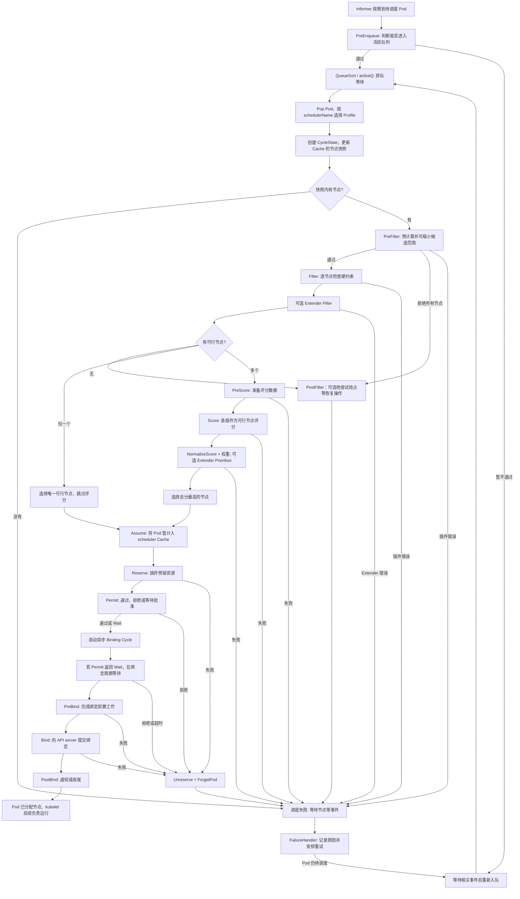

# 普通 Pod 的 kube-scheduler 调度流程

本文对应此仓库的单 Pod 路径，不包括 PodGroup 调度。主线是：**入队 → 找到可行节点 → 比较节点 → 在本地假定占用 → 绑定**。`PostFilter` 是失败分支，不是每个 Pod 都经过的固定阶段。

## 流程图

图中的“等待相关事件后重新入队”是简化表示：失败的 Pod 可能留在 unschedulable 集合，或经 backoffQ 延迟后回到 activeQ；具体取决于失败原因、事件和退避状态。Pod 已被删除或已经绑定时不会重新入队。Bind 成功表示 **Pod 被分配到节点**，不表示容器已经 `Running`。

## 两个周期与各阶段

单 Pod 的**调度周期**同步地选择节点、执行本地 `Assume`、`Reserve` 和 `Permit`；之后启动可以与后续 Pod 调度重叠的**绑定周期**。节点的 Filter 工作可以并行，但共享算法实例的 Pod 调度周期是串行的。入口见 [`ScheduleOne`](pkg/scheduler/schedule_one.go) 和 [`scheduleOnePod`](pkg/scheduler/schedule_one.go)。

| 环节 | 作用 | 典型例子 / 结果 |
| --- | --- | --- |
| `PreEnqueue`、`QueueSort` | 控制 Pod 能否进入活跃队列及取出顺序 | SchedulingGates、PrioritySort；不负责选择节点 |
| 快照、`CycleState` | 从持续更新的 Cache 获取本轮节点视图，并存放插件共享的中间计算结果 | [`schedulingCycle`](pkg/scheduler/schedule_one.go) |
| `PreFilter` | 在遍历节点前预计算数据，也可缩小候选节点集合 | 汇总 Pod 资源需求；[`prefilterNodes`](pkg/scheduler/algorithm.go) |
| `Filter` | 对候选节点执行硬约束检查；不通过的节点不能靠 Score 加分挽救 | NodeResourcesFit、NodeAffinity、TaintToleration、VolumeBinding；之后可执行 Extender Filter |
| `PostFilter` | **没有可行节点时**的恢复路径；默认抢占插件可尝试为下一轮腾出资源 | DefaultPreemption；提名节点不等于本轮绑定成功 |
| `PreScore` | 为各评分插件预计算候选节点相关数据 | 准备拓扑、亲和性等评分状态 |
| `Score` | 对可行节点表达软偏好 | 得分不会让被 Filter 拒绝的节点重新可用 |
| `NormalizeScore` 与权重 | 将各插件分数归一化并按配置权重相加，再加入可选 Extender Prioritize 分数 | 总分最高的节点成为候选；不是按 Pod Priority 排序 |
| `Assume` | 在 scheduler 本地 Cache 中暂时计入已选节点的资源占用 | 此时 API server 尚未完成绑定；避免后续调度遗漏该占用 |
| `Reserve`、`Permit` | 插件预留自身状态；Permit 可通过、拒绝或等待 | Reserve 失败或 Permit 拒绝需要回滚 |
| Permit 等待、`PreBind`、`Bind`、`PostBind` | 绑定周期等待批准、完成卷等前置操作、提交绑定并收尾 | DefaultBinder 调用绑定 API；绑定失败时撤销本地假定 |

## 关键分支和边界

1. **`PostFilter` 在哪里？** [`SchedulePod`](pkg/scheduler/algorithm.go) 找不到可行节点时返回 `FitError`；[`schedulingAlgorithm`](pkg/scheduler/schedule_one.go) 才尝试调用 `RunPostFilterPlugins`。没有任何节点时返回 `ErrNoNodesAvailable`，此路径直接失败；其他算法错误也不会因此自动进入抢占。进入 `PostFilter` 不保证能找到 victim。
2. **什么情况下不评分？** 只有一个可行节点时，`SchedulePod` 直接选它；有多个候选才进入 [`prioritizeNodes`](pkg/scheduler/schedule_one.go) 的 `PreScore`、`Score`、归一化/加权和可选 Extender Prioritize。调度器为了效率也可能只收集一部分可行节点参加评分。
3. **抢占是否立刻绑定？** 默认 `PostFilter` 可驱逐低优先级 victim，并为抢占者提名一个节点；随后本轮仍按调度失败处理。待资源实际释放后，Pod 重新尝试调度，提名不构成资源锁定。
4. **`Assume` 与 `Bind` 有何不同？** [`AssumeAndReserveInCache`](pkg/scheduler/algorithm.go) 只更新本地资源记账并执行 Reserve；`Bind` 才将 Pod 到节点的分配提交给 API server。假定让后续 Pod 能在前一个绑定尚未完成时看到它的占用。
5. **失败怎么回滚？** Reserve 失败时算法负责 `UnreserveAndForgetFromCache`；Permit 拒绝时调度周期回滚；绑定周期中 Permit 等待、PreBind 或 Bind 失败时调用 [`handleBindingCycleError`](pkg/scheduler/schedule_one.go) 撤销假定，再交给 `FailureHandler`。插件错误和不可调度属于不同失败类型，重试路径也会不同。

## 源码导航

- [`pkg/scheduler/scheduler.go`](pkg/scheduler/scheduler.go)：构造 Queue、Cache、Profiles，并启动 `ScheduleOne` 循环。
- [`pkg/scheduler/schedule_one.go`](pkg/scheduler/schedule_one.go)：单 Pod 调度与绑定周期、`PostFilter` 入口、失败处理。
- [`pkg/scheduler/algorithm.go`](pkg/scheduler/algorithm.go)：`PreFilter`、`Filter`、节点选择以及 `Assume`/`Reserve`。
- [`pkg/scheduler/framework/runtime/framework.go`](pkg/scheduler/framework/runtime/framework.go)：调用插件、评分归一化及权重合并。
- [`pkg/scheduler/framework/plugins/defaultpreemption/default_preemption.go`](pkg/scheduler/framework/plugins/defaultpreemption/default_preemption.go)：默认 `PostFilter` 抢占插件。
- [`pkg/scheduler/backend/queue/scheduling_queue.go`](pkg/scheduler/backend/queue/scheduling_queue.go)：activeQ、backoffQ 和 unschedulable 集合。
